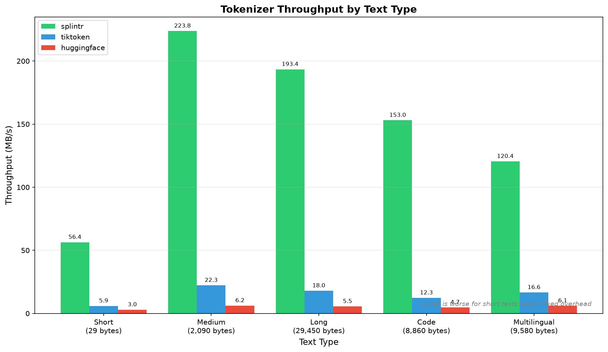
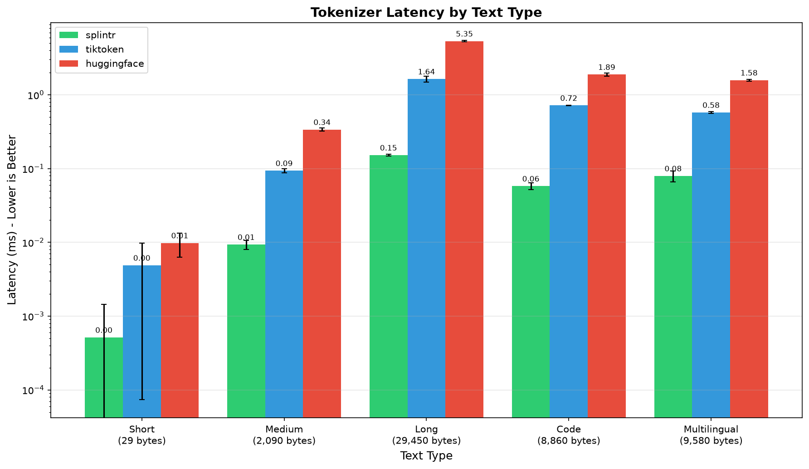
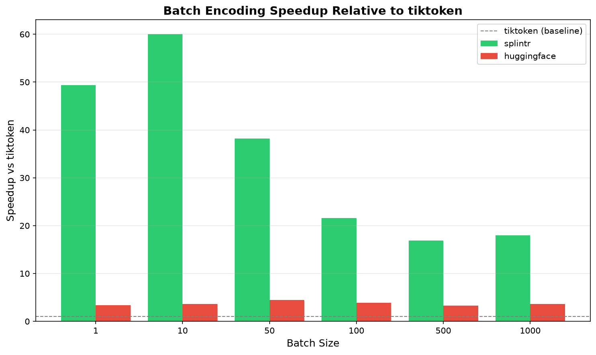
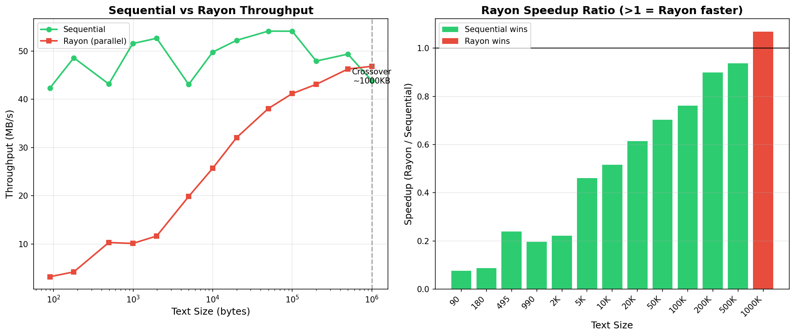

# Performance Benchmarks

All figures on this page were measured by the scripts in `benchmarks/` — `benchmark_batch.py` for batch throughput, `benchmark_single.py` for single-text latency — on an AMD Ryzen 9 5900X (12 cores / 24 threads, Linux), against **splintr 0.19.1, tiktoken 0.13.0 and Hugging Face tokenizers 0.23.1** on CPython 3.12.7. `benchmarks/requirements.txt` pins the reference libraries, so a re-run measures this comparison rather than whatever a resolver picks.

Every engine encodes the **same vocabulary**, `cl100k_base`, each loaded through its own `from_pretrained`: splintr from its bundled copy, tiktoken from its cached ranks file, HuggingFace from `Xenova/gpt-4` — that same vocabulary published as a `tokenizer.json`. Loading is outside the timed section, so the loader is not what these figures measure.

Both scripts refuse to report a timing until all three engines produce identical ids, so a loader mistake shows up as a failed run rather than a fast-looking chart.

Absolute throughput moves with the hardware, the CPU architecture and the versions being compared against, so every figure here describes one run rather than a constant. Run the scripts to get your own.

The [README](../README.md#performance) quotes the same run. For a broader like-for-like measurement across vocabularies, the manually triggered `perf` workflow (`gh workflow run perf.yml`) verifies every engine produces identical ids before it reads any timing — its [run history](https://github.com/ml-rust/splintr/actions/workflows/perf.yml) carries the most recent report.

Every figure is the **default pure-Rust `regexr` backend** — what `pip install splintr-rs` gives you, since published wheels omit the optional `pcre2` feature. See [Regex Backends](#regex-backends) for what PCRE2 changes.

The charts below are plotted from that same run, so their axes and the figures quoted in the text are the same measurement.

## Single Text Encoding

For single texts, splintr encodes **~7-12x faster** than tiktoken and **~19-36x faster** than HuggingFace across five text types (short prose, medium prose, long prose, Python code, multilingual):



**Latency by content type:**



Consistent low latency across Python code, JSON, English prose, and Chinese text makes splintr ideal for interactive applications and real-time processing.

## Batch Encoding

Splintr parallelizes across texts, where the widest gap appears:



The speedup appears as soon as there is more than one text to spread across cores; from there it is roughly flat, since the pool is already saturated.

## Design Decision: Sequential by Default

Splintr uses **sequential encoding for single texts** and **parallel encoding across batches** based on empirical benchmarking:



**Key findings:**

- Sequential is faster for texts up to ~1MB (typical LLM prompts and documents)
- Rayon's parallelization overhead only pays off at ~1MB+ text sizes
- Most real-world inputs are well under 1MB
- `encode()` uses sequential processing for optimal single-text performance
- `encode_batch()` parallelizes across multiple texts for maximum throughput
- `encode_rayon()` available for the rare cases where you have >1MB single texts

This architecture ensures splintr is optimized for the most common tokenization patterns in LLM applications.

## Running Benchmarks Yourself

```bash
# Clone and install
git clone https://github.com/ml-rust/splintr.git
cd splintr
pip install -e .
pip install -r benchmarks/requirements.txt

# The two scripts that produced the figures above
python benchmarks/benchmark_batch.py    # batch throughput table + speedup charts
python benchmarks/benchmark_single.py   # single-text throughput + latency charts

# The broader suite, written to a file
cd benchmarks
python benchmark.py --model cl100k_base --output results/my_benchmark.json
cat results/my_benchmark.md
```

`benchmark.py` covers single text encoding, batch encoding, streaming decoder performance, and special token handling across various content types. Expect different absolute numbers on different hardware and with different versions of comparison libraries — record which you ran against before quoting a figure.

## Regex Backends

Splintr uses a pure-Rust regex engine ([`regexr`](https://crates.io/crates/regexr)) by default, with optional PCRE2 support.

The two are not equally fast, and every performance figure on this page is the default one. Measured on the machine described above, PCRE2 encodes a **single text** about 1.1-1.5x faster than regexr — the gap widens on multilingual input — and is **level on batch encoding**, where Rayon rather than the regex engine sets the pace. Both produce identical token ids; the choice is a speed/dependency trade-off, not a correctness one. Quote a PCRE2 number only as a PCRE2 number: the published wheels do not carry the feature.

**Default Backend (regexr):**

- Pure Rust implementation (no C dependencies)
- JIT compilation and SIMD acceleration
- Native UTF-8 and Unicode property support

**Optional PCRE2 Backend:**

```python
from splintr import Tokenizer

# Default: regexr backend (pure Rust)
tokenizer = Tokenizer.from_pretrained("cl100k_base")

# Optional: switch to PCRE2 (requires --features pcre2)
tokenizer = Tokenizer.from_pretrained("cl100k_base").pcre2(True)
```

To enable PCRE2, build with the feature flag:

```bash
maturin develop --release --features python,pcre2
```

`python` has to be listed alongside it: `--features` replaces the default set rather than adding to it, and dropping the PyO3 feature leaves maturin with no binding to build.

**Benchmarking:**

```bash
# Compare backends (requires PCRE2 feature)
python benchmarks/benchmark_regexr_comparison.py --model cl100k_base

# Visual comparison with charts
python benchmarks/benchmark_regexr_viz.py --model cl100k_base
```

## Published Tables

These tables come from the same run as the charts above.
They use the default `regexr` backend and the scripts named in [Running Benchmarks Yourself](#running-benchmarks-yourself).

### Batch

| Batch       | Splintr        | tiktoken  | HF `tokenizers` | vs tiktoken | vs HF |
| ----------- | -------------- | --------- | --------------- | ----------- | ----- |
| 1,000 texts | **170.0 MB/s** | 9.5 MB/s  | 34.3 MB/s       | 18.0x       | 5.0x  |
| 500 texts   | **170.7 MB/s** | 10.1 MB/s | 33.2 MB/s       | 16.9x       | 5.1x  |
| 100 texts   | **148.3 MB/s** | 6.9 MB/s  | 26.9 MB/s       | 21.6x       | 5.5x  |

### Single text, sequential path

| Text         | Splintr      | tiktoken | HF `tokenizers` | vs tiktoken | vs HF |
| ------------ | ------------ | -------- | --------------- | ----------- | ----- |
| 29 KB prose  | **0.152 ms** | 1.639 ms | 5.346 ms        | 10.8x       | 35.2x |
| 8.9 KB code  | **0.058 ms** | 0.718 ms | 1.888 ms        | 12.4x       | 32.5x |
| 9.6 KB mixed | **0.080 ms** | 0.577 ms | 1.582 ms        | 7.2x        | 19.8x |

Summary ratios: about 18x tiktoken and 5x HuggingFace on batches, and about 10x and 35x on single texts.
The ratios shift across machines.

### Other Rust tokenizers

Every engine loads the same `tokenizer.json`.

| Axis            | vs HF `tokenizers`  | vs `gigatoken`                                          |
| --------------- | ------------------- | ------------------------------------------------------- |
| Vocabulary load | **Splintr** (~1.5x) | **Splintr** (2-4x)                                      |
| Single text     | **Splintr** (~35x)  | **Splintr** on x86-64 (~1.5x), **tie** on Apple Silicon |
| Batch           | **Splintr** (~5x)   | **Toss-up** — either engine, ±20% each way              |

`gigatoken` is the other fast Rust tokenizer with Python bindings.

- The batch winner flips by machine, by vocabulary, and by output form. Read one row as one data point.
- Load is the one axis where splintr leads everywhere. Bundled vocabularies are packed binary and borrowed, not copied.

### Current numbers

The tables above are a dated snapshot. Two ways get current numbers:

- [Latest perf run](https://github.com/ml-rust/splintr/actions/workflows/perf.yml). Each run publishes its hardware, library versions, id-parity check, and every vocabulary and corpus.
- Run it yourself with `gh workflow run perf.yml` on a fork, or run `.github/scripts/perf_bench.py` and `perf_report.py` locally. The scripts build the checkout, so a branch measures before release. They refuse to report timings for engines that disagree on ids.
